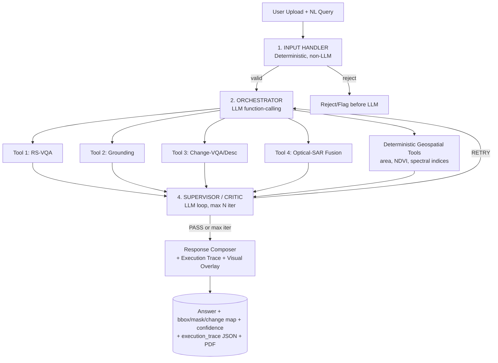

# Satiq — SatQuery AI

> Multi-agent, chat-based system that answers natural-language questions about remote-sensing imagery. Agentic orchestration over 4 capability models — not dozens of narrow models — with auditable execution traces and visual evidence.

Single-image, cross-modal **Optical+SAR**, and bi-temporal analysis routed through a deterministic input gate → LLM orchestrator (function-calling) → capability tools → supervisor/critic loop → composer.

---

## 1. Input Configurations

| # | Configuration | Upload | Example Query |
|---|---------------|--------|---------------|
| 1 | **Single Image** | 1× GeoTIFF (optical / multispectral / SAR) | "What land cover is present? Count built-up clusters." |
| 2 | **Cross-Modal Pair** | Co-registered Optical + SAR (same AOI) | "Identify crop and water regions using optical+SAR" |
| 3 | **Bi-Temporal Pair** | Co-registered t1 + t2 (same AOI, different dates) | "Has built-up area increased? What changed and where?" |

> GeoTIFF/TIFF required for production; PNG/JPEG accepted only for benchmarks (VRSBench/RSVQA/CDVQA). SAR = Sentinel-1 style backscatter; Optical = Sentinel-2 / Cartosat-2S.

---

## 2. Architecture



### 2.1 Input Handler — Deterministic Gatekeeper (no LLM cost on invalid input)

* File format validation — GeoTIFF/TIFF; PNG/JPEG only for benchmarks
* Modality detection — band count + metadata → optical / multispectral / SAR / pair
* Metadata extraction — CRS, pixel resolution/GSD, band list, acquisition timestamp
* Co-registration / pairing check — for cross-modal & bi-temporal (same AOI, CRS alignment, resolution resampling)
* Rejects/flags incompatible input **before** it reaches the LLM
* Radiometric + resolution normalization (common GSD, reflectance/backscatter scaling) to mitigate Sentinel ↔ Cartosat-2S / RISAT domain gap

### 2.2 Orchestrator — LLM with Function-Calling / Tool-Use

Single LLM call (instruction-tuned, can be small open model — routing, not perception). Responsibilities:

* Query normalization & task-type classification
* Cross-check task vs. input configuration (e.g., reject `change detection` if only 1 image supplied)
* Select tools + emit auditable JSON: `{"tool": "...", "params": {"question": "..."}}`
* May chain sequentially (e.g., `Fusion → VQA`)
* Emits structured `execution_trace`: task type, tools called, parameters, iteration count

> Prompt-injection hardening on params; output is auditable, not free-text tool names.

### 2.3 Capability Tools (4 Models)

| Tool | Model | Purpose |
|------|-------|---------|
| **Tool 1** | **RS-VQA** | Free-form / close-ended QA on single image (land cover, presence/counts, spatial relations) |
| **Tool 2** | **Grounding** | Text-guided localization → bbox `(x,y,w,h)` or mask + confidence (visual evidence) |
| **Tool 3** | **Change-VQA / Change Description** | Bi-temporal: answers "what changed?" + optional binary/multi-class change mask |
| **Tool 4** | **Optical-SAR Fusion** | Cross-attention joint extraction from co-registered optical+SAR → text summary + spatial map |

Deterministic geospatial helpers (no ML): `area_calculator.py`, `ndvi.py`, `spectral_indices.py`.

### 2.4 Supervisor / Critic — Loop Controller

```python
iteration = 0
while iteration < MAX_ITER:
    iteration += 1
    result = execute(orchestrator_plan)
    verdict = critic(result)  # checks: answer relevance, tool-call legality, visual_evidence
    if verdict == PASS or iteration == MAX_ITER:
        finalize(result, iteration)
        break
    else:
        revise_and_retry()
```

Checks: answer relevance (does text address the question?), tool-call legality (incompatible tool for input type?), visual evidence (overlay present: bbox / segmentation / change heatmap), confidence calibration.

### 2.5 Response Composer (VLM — single LLM call)

Fuses tool outputs → final answer + visual overlay + confidence + `execution_trace`. Also drives PDF report generation (WeasyPrint) from structured JSON.

---

## 3. The 4 Models — Specs & Adaptation

Adaptation is **remote-sensing adaptation**: fine-tune vision encoder + cross-modal projection on RS data; language decoder via LoRA/QLoRA; heads only where needed. Two-stage pattern for every text-generation model:

* **Stage 1 — Representation warm-start:** freeze vision encoder, train projection/fusion layer on image–text pairs (BigEarthNet labels/captions)
* **Stage 2 — Instruction tuning:** LoRA on LLM decoder (+ last vision blocks), train on task QA pairs (VRSBench / RSVQA / CDVQA)

| Model | Input | Output | Backbone Recommendation | Training Data |
|-------|-------|--------|-------------------------|---------------|
| **1 — RS-VQA** | 1 image + question string | Text answer + confidence | RS-pretrained VLM (e.g., RS-LLaVA / GeoChat-style) or CLIP-RS + Phi-2/3-mini; freeze encoder → train MLP projection, then LoRA on decoder | Stage1: BigEarthNet S1+S2 image–text pairs · Stage2: VRSBench + RSVQA QA |
| **2 — Grounding** | 1 image + referring expression | bbox/mask + confidence | GroundingDINO (Swin backbone) + optional SAM for mask refinement; fine-tune cross-attention/fusion, box + objectness head | BigEarthNet-derived region annotations + VRSBench grounding |
| **3 — Change-VQA/Desc** | 2 co-registered images (t1,t2) + question | Text change description + optional change map | Bi-temporal encoder (IBM-NASA geospatial FM or similar) → difference/attention fusion → shared decoder | Stage1: BigEarthNet bi-temporal tiles (self-supervised change) · Stage2: CDVQA QA + optional segmentation head |
| **4 — Optical-SAR Fusion** | Co-registered optical + SAR + query | Joint text summary + spatial map/mask + per-class confidence | CROMA (Contrastive Radar-Optical MAE) — pretrained on Sentinel-1+2 pairs; fallback: separate S1/S2 encoders + cross-attention fusion | Stage1: BigEarthNet S1+S2 multi-label land-cover (fusion + seg head) · Stage2: LoRA text decoder on synthetic/VRSBench descriptions |

> **Domain gap note:** Sentinel-1/2 (pretraining) vs. Cartosat-2S + RISAT (deployment) differ in GSD, band count, radiometry. Mitigations: (1) Input Handler resampling/normalization, (2) CORAL / few-shot feature adaptation, (3) qualitative sanity-check on target sensors. BigEarthNet S1+S2 is primary — prioritize Model 4 early.

---

## 4. Repository Structure

```
satiq/
├── frontend/                    # React + TS + MapLibre
│   ├── src/
│   │   ├── workspace/           # map + chat + evidence inspector
│   │   ├── components/
│   │   │   ├── ExecutionTrace/  # key UI differentiator — auditable trace
│   │   │   ├── EvidencePanel/
│   │   │   └── ModalityView/    # optical vs SAR split view
│   │   └── hooks/
├── gateway/                     # Node/Express + TypeScript
│   ├── routes/
│   ├── upload/                  # GeoTIFF handling
│   └── session/
├── orchestrator/                # Python — core system
│   ├── models/
│   │   ├── raster_asset.py      # Pydantic — build first
│   │   └── analysis_result.py   # Pydantic — build first
│   ├── ingestion/
│   │   └── validator.py         # CRS hard gate — build second
│   ├── understanding/
│   │   └── query_normalizer.py
│   ├── planner/
│   │   └── llm_planner.py       # single LLM call
│   ├── registry/
│   │   ├── capability_registry.py
│   │   └── topo_resolver.py     # auto-prerequisite resolution
│   ├── engine/
│   │   ├── execution_engine.py
│   │   └── result_cache.py
│   ├── evidence/
│   │   ├── evidence_graph.py
│   │   └── confidence_engine.py
│   └── composer/
│       └── vlm_composer.py      # single LLM call
├── capabilities/                # isolated per capability
│   ├── single_image/
│   │   ├── vqa.py               # GeoChat wrapper
│   │   ├── caption.py
│   │   └── grounding.py         # GroundingDINO wrapper
│   ├── temporal/
│   │   ├── change_vqa.py        # ChangeChat wrapper
│   │   ├── change_map.py        # Siamese UNet
│   │   └── alignment.py         # raster co-registration
│   ├── fusion/
│   │   └── optical_sar.py       # cross-attention fusion
│   └── geospatial/
│       ├── area_calculator.py   # deterministic, no ML
│       ├── ndvi.py
│       └── spectral_indices.py
├── adaptation/                  # BigEarthNet fine-tuning
│   ├── train.py
│   ├── eval.py
│   └── configs/
├── evaluation/                  # benchmark harness
│   ├── evaluate.py
│   ├── suites/
│   │   ├── vrsbench.py
│   │   ├── rsvqa.py
│   │   └── cdvqa.py
│   └── reports/
└── docker-compose.yml
```

---

## 5. Mandatory Requirements → How Satiq Satisfies Them

| Requirement | Satisfied By |
|-------------|--------------|
| **Remote-sensing adaptation** | Fine-tuned RS-VLM / CROMA / geospatial FM on BigEarthNet S1+S2 (not generic COCO) |
| **Captioning OR Grounding** | Model 2 Grounding (bbox/mask) — doubles as visual evidence; captioning as auxiliary |
| **Multi-image change analysis** | Model 3 Change-VQA + change map (bi-temporal) |
| **Optical-SAR fusion** | Model 4 cross-attention fusion (complementary info) |
| **Agentic orchestration** | Orchestrator (function-calling) + Supervisor/Critic loop |
| **Input compatibility checking** | Input Handler deterministic gatekeeper + orchestrator cross-check |
| **Auditable execution summary** | `execution_trace` (task, tools, params, iterations) + visual overlay + confidence |

---

## 6. Tech Stack

| Layer | Choice |
|-------|--------|
| **Frontend** | React + TypeScript + MapLibre GL, ExecutionTrace / EvidencePanel / ModalityView |
| **Gateway** | Node / Express + TypeScript, GeoTIFF upload, session management |
| **Orchestrator** | Python, Pydantic models, LLM function-calling (small instruction model or hosted API), deterministic validator |
| **Capabilities** | GeoChat, GroundingDINO (+ SAM optional), ChangeChat / Siamese UNet, CROMA, geospatial deterministics |
| **Adaptation** | BigEarthNet S1+S2, VRSBench / RSVQA / CDVQA, LoRA/QLoRA, cross-attention fusion |
| **Reports** | Server-side PDF (WeasyPrint) from `execution_trace` + results JSON |
| **Infra** | `docker-compose.yml` (frontend / gateway / orchestrator) |

---

## 7. Build Priority (Hackathon Order)

1. **Pydantic models** `raster_asset.py` + `analysis_result.py` → then **CRS hard gate** `validator.py`
2. **Model 4 Fusion** — most tied to primary dataset (BigEarthNet S1+S2)
3. **Model 3 Change-VQA** — second mandatory multi-image capability
4. **Model 1 RS-VQA + Model 2 Grounding** (leverage existing RS-VLM / GroundingDINO checkpoints)
5. **Orchestrator + Supervisor loop** (function-calling, legality checks, retry)
6. **Response Composer polish** — overlays, confidence, execution trace, PDF report
7. **Frontend workspace** — map + chat + trace inspector (the differentiator)

---

## 8. Getting Started

```bash
# scaffold only — services stubbed, uncomment in docker-compose.yml as implemented
docker compose up --build

# when repos are connected
git remote add origin https://github.com/<you>/satiq.git
git push -u origin main
```

> Current state: scaffold complete (`aa6fef2`), no model/LLM code yet. Follow build priority above.

---

## 9. Evaluation

```bash
python evaluation/evaluate.py --suite vrsbench
python evaluation/evaluate.py --suite rsvqa
python evaluation/evaluate.py --suite cdvqa
# reports → evaluation/reports/
```

Benchmarks: VRSBench (VQA + grounding + captioning), RSVQA, CDVQA. BigEarthNet for RS adaptation warm-start.

---

**License:** TBD · **Status:** Scaffold — architecture locked, implementation next.
