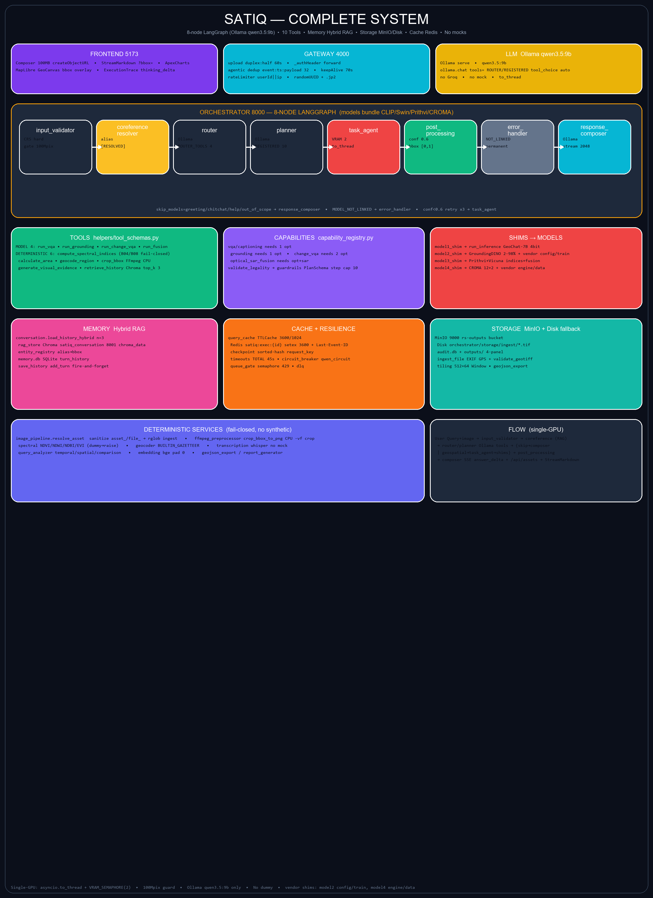

# SATIQ — Complete System Architecture

> Generated 2026-09-05 — single source: `orchestrator/graph/complete_system.py`
> Ollama qwen3.5:9b ONLY • 8-node LangGraph • 10 tools • Hybrid RAG • No mocks

## Full Mermaid (paste at https://mermaid.live)



Source Mermaid and ASCII at `orchestrator/graph/complete_system.mmd/.txt` and `docs/complete_system.mmd/.txt`.

```mermaid
# see orchestrator/graph/complete_system.mmd for full 7819-char Mermaid
```

## Layers at a glance

| Layer | Components | Key files |
|-------|------------|-----------|
| **Frontend 5173** | Composer 100MB createObjectURL, StreamMarkdown `?bbox=` parse (heuristic disabled), MapLibre, ExecutionTrace, analysisClient abort-safe | `frontend/src/components/chat/Composer.tsx:114`, `StreamMarkdown.tsx:262`, `lib/analysisClient.ts:57` |
| **Gateway 4000** | keepAlive 70s, upload duplex:half 60s + randomUUID .jp2, rateLimiter userId\|\|ip, agentic dedup 32 + _authHeader | `gateway/src/index.ts:107`, `routes/upload.ts:37`, `analysis/providers/agentic-analysis.provider.ts:40` |
| **Orchestrator 8000 8-node** | `input_validator → coreference_resolver → router → planner → task_agent → post_processing → error_handler → response_composer` • Ollama `ollama.chat` + `ROUTER_TOOLS 4`/`REGISTERED_TOOLS 10` via `to_thread`, VRAM 2, 45s budget | `graph/pipeline.py:65`, `core/llm_client.py:500`, `agents/task_agents.py:20` |
| **Tools (10)** | `run_vqa, run_grounding, run_change_vqa, run_fusion` + `compute_spectral_indices, calculate_area, geocode_region, crop_bbox, generate_visual_evidence, retrieve_history` | `helpers/tool_schemas.py:13` |
| **Capabilities** | `vqa/captioning (1 opt), grounding (1), change_vqa (2), optical_sar_fusion (opt+sar)` + DETERMINISTIC | `registry/capability_registry.py:8` |
| **Shims → Models** | `model1 GeoChat-7B`, `model2 GroundingDINO Swin-T + vendor config/train`, `model3 Prithvi+Vicuna`, `model4 CROMA 12+2 + vendor engine/data` | `capabilities/shims/model{1..4}_shim.py`, `capabilities/model_adapter.py:20`, `models/model2/config.py`, `models/model4/engine.py` |
| **Memory Hybrid RAG** | `load_history_hybrid n=3`, Chroma `satiq_conversation:8001` + SQLite `memory.db`, `entity_registry`, `add_turn` | `memory/rag_store.py`, `services/conversation.py`, `memory/entity_registry.py` |
| **Cache+Resilience** | `query_cache 3600/1024`, Redis `satiq:exec:{id} setex 3600 + Last-Event-ID`, checkpoint, timeouts 45s, circuit_breaker, queue_gate 429 | `core/query_cache.py`, `core/redis_state.py`, `core/timeouts.py:22` |
| **Storage** | MinIO 9000 `rs-outputs` + disk `orchestrator/storage/ingest/*.tif, audit.db`, `tiling 512+64 Window`, `geojson_export/report_generator` | `services/minio_client.py`, `services/image_ingest.py`, `services/tiling.py:1` |
| **Services** | `image_pipeline.resolve_asset`, `ffmpeg crop_bbox_to_png CPU`, `spectral fail-closed`, `geocoder BUILTIN_GAZETTEER`, `transcription no mock`, `query_analyzer` | `services/ffmpeg_preprocessor.py:14`, `services/spectral.py:97` |

## How to regenerate

```powershell
python orchestrator/graph/complete_system.py   # writes .mmd/.txt/.png (Pillow, no matplotlib needed)
python orchestrator/graph/visualize.py         # simple 8-node graph.mmd/txt (LangGraph PNG needs graphviz)
```

## Verification

- `orchestrator/graph/complete_system.mmd` 7819 chars Mermaid with subgraphs Frontend/Gateway/Orchestrator/Tools/Capabilities/Shims/Memory/Cache/Storage/Services + cross-links.
- `orchestrator/graph/complete_system.png` 2400×3300 RGB via Pillow 12.3.0 (also copied to `docs/complete_system.png` and `frontend/public/` if present).
- Simple `graph.mmd/txt` now reflect Ollama qwen3.5:9b (was Groq) per user directive.
